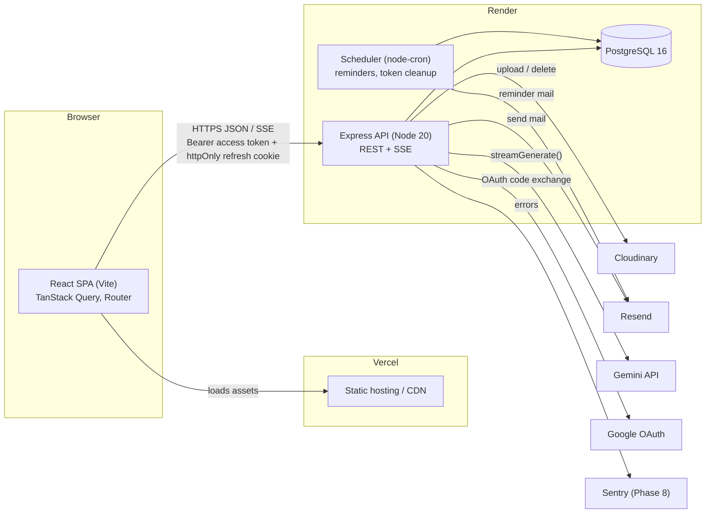
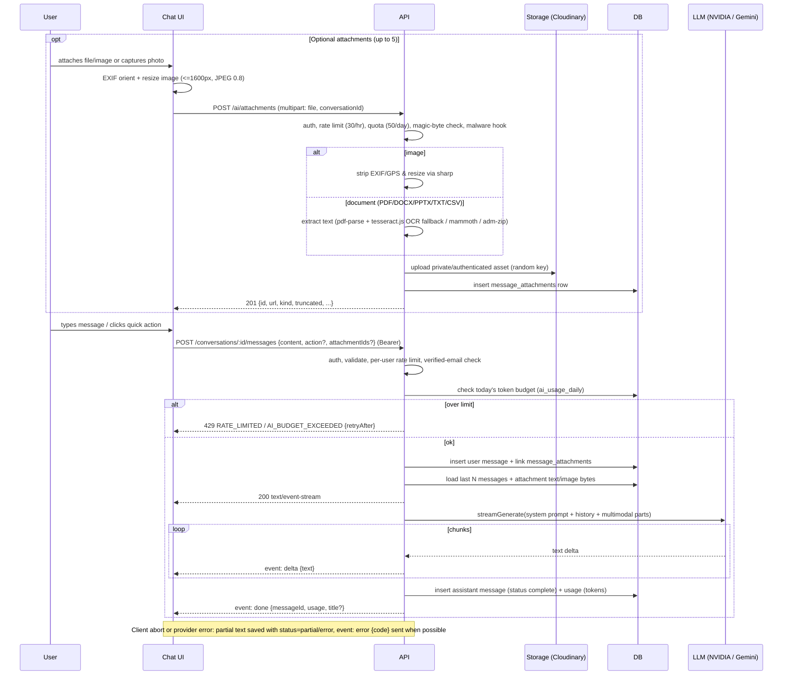
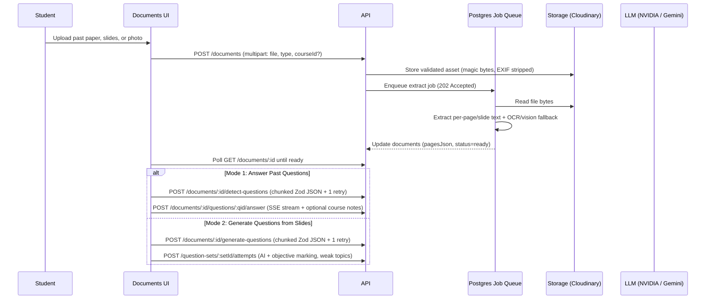

# Architecture

## 1. Principles
Simple over clever · one language (TypeScript) end to end · a modular monolith (one API process, one DB) · stateless API so it scales horizontally · secrets only on the server.

## 2. System diagram



The scheduler runs inside the API process (one instance in v1). Jobs are idempotent (`reminderSentAt` guard under `UPDATE ... WHERE ... RETURNING`), so a second instance cannot double-send.

## 3. Component breakdown

### 3.1 Client (`client/`)
```
src/
  app/          router, providers (QueryClient, Auth, Theme), layout shell
  design/       tokens.css, tailwind preset, primitives (Button, Input, Card, Modal, Toast, Skeleton, EmptyState, ErrorState)
  features/
    auth/       LoginPage, SignupPage, Forgot/Reset/Verify pages, useAuth, schemas (Zod)
    profile/    ProfilePage, AvatarUploader, StatsGrid, SecurityForm
    chat/       ChatPage, ConversationList, MessageList, Composer, Markdown, useChatStream
    notes/      NotesPage, NoteEditor, CourseSidebar
    planner/    PlannerPage, TaskForm, NotificationBell
    focus/      PomodoroPage, useTimer
    study/      DecksPage, StudyMode, QuizPage, QuizResults, ScoreChart
    dashboard/  DashboardPage
    settings/   SettingsPage
  lib/          apiClient (fetch wrapper, refresh logic), sse.ts, format.ts
```
- **Server state:** TanStack Query (cache, retries, optimistic updates). **UI state:** local component state / context. No Redux.
- **Access token** lives in memory only (never localStorage). On load, `POST /auth/refresh` restores the session via cookie.
- **Routing:** public `AuthLayout` routes, `RequireAuth` wrapper for app routes, lazy-loaded route chunks.
- **Streaming:** `fetch()` + `ReadableStream` parser (not `EventSource`, since we need POST + Authorization header).

### 3.2 Server (`server/`)
```
src/
  config/       env.ts (Zod-validated env; app refuses to boot if invalid)
  middleware/   requestId, httpLogger, auth, validate, rateLimit, csrfGuard, errorHandler, notFound
  modules/      auth, users, conversations, ai, notes, courses, tasks, notifications,
                studySessions, decks, quizzes, dashboard, health
                (each: routes.ts, controller.ts, service.ts, schemas.ts, *.test.ts)
  lib/          prisma, email (Resend + templates), storage (Cloudinary), tokens, password (argon2), llm/ (provider interface + gemini.ts), logger
  jobs/         reminders.ts, cleanup.ts
  app.ts / server.ts
prisma/         schema.prisma, migrations/, seed (dev-only, creates no users in prod)
```
Layering: **routes → controller (HTTP only) → service (business rules, Prisma) → lib (external systems)**. Controllers never touch Prisma; services never touch `req/res`.

### 3.3 Cross-cutting
| Concern | Approach |
|---|---|
| Validation | Zod schema per route for `body`, `query`, `params`; shared shapes are duplicated in client schemas where needed (small, avoids a shared package) |
| Errors | `AppError(code, status, message, details)`; one `errorHandler` formats `{ error: { code, message, details?, requestId } }`; unknown errors become `INTERNAL` and are logged, never leaked |
| Logging | pino JSON, `pino-http` with request ID, redacts `authorization`, `cookie`, `password`, tokens |
| Config | Env validated at boot; `.env.example` is complete and committed, `.env` is not |
| AI abstraction | `LLMProvider { stream(messages, opts): AsyncIterable<Chunk>; generateJson(prompt, schema) }`; Gemini implementation first |

## 4. Authentication flow

```mermaid
sequenceDiagram
  participant B as Browser (SPA)
  participant A as API
  participant D as DB
  participant M as Email (Resend)

  Note over B,A: Sign up
  B->>A: POST /auth/signup {name,email,password}
  A->>D: insert user (argon2id hash), email token (hash only)
  A->>M: verification link /verify-email?token=...
  A-->>B: 201 {accessToken, user} + Set-Cookie refresh (httpOnly, Secure, SameSite)

  Note over B,A: Authenticated request
  B->>A: GET /users/me  Authorization: Bearer access
  A-->>B: 200

  Note over B,A: Silent refresh (access expired or page reload)
  B->>A: POST /auth/refresh (cookie) + X-Requested-With header
  A->>D: find token by hash; if revoked => revoke whole family, 401
  A->>D: rotate: revoke old, insert new (same family)
  A-->>B: 200 {accessToken} + new cookie

  Note over B,A: Password reset
  B->>A: POST /auth/forgot-password {email}
  A-->>B: 202 (always same response)
  A->>M: link /reset-password?token=... (if user exists)
  B->>A: POST /auth/reset-password {token,password}
  A->>D: set hash, mark token used, revoke all refresh tokens
```

**Client refresh logic:** `apiClient` on a `401 TOKEN_EXPIRED` performs one shared refresh promise (so parallel calls don't stampede), then retries the original request once. A failed refresh clears the session and redirects to `/login?next=...`.

**Google OAuth:** `GET /auth/google` sets a short-lived `state`+PKCE cookie and redirects to Google; `/auth/google/callback` verifies state, exchanges the code, requires `email_verified`, finds/links/creates the user, sets the refresh cookie, and redirects to the client at `/auth/callback`, where the SPA calls `/auth/refresh` to obtain its access token (no tokens in URLs).

## 5. AI chat flow



**SSE events:** `meta` (message ids) · `delta` `{text}` · `done` `{messageId, usage, title?}` · `error` `{code,message}`. Heartbeat comment every 15 s. Server aborts the upstream call when the client disconnects (`req.on('close')`).

**Quick actions** are server-defined templates (`explain_simple`, `example`, `quiz_me`, `summarize`) that wrap the target text; the client sends `action` + optional `selection`, never raw system instructions.

**Tutor system prompt (stored in code, versioned):** patient university tutor; step-by-step; short paragraphs; use Markdown/code fences; check understanding; end with one follow-up question; admit uncertainty; don't just give answers to graded-assessment style requests without explaining reasoning; decline unsafe requests politely.

**Context management:** last ≤ 20 messages and ≤ ~6k estimated input tokens; older messages dropped (summarisation is out of scope for v1).

**Structured AI (summaries, flashcards, quizzes):** non-streaming `generateJson` with a response schema; output validated with Zod; one automatic retry on invalid JSON; failure returns `AI_BAD_OUTPUT` and nothing is saved.

### 5.1 Study from Documents flow



## 6. Reminders flow
`node-cron` every minute: `SELECT` tasks where `remindAt <= now() AND reminderSentAt IS NULL AND status != 'done'`, claim each with `UPDATE ... SET reminderSentAt = now() WHERE id=? AND reminderSentAt IS NULL RETURNING`, insert a `notifications` row, and send email if the user opted in and is verified. The client polls `GET /notifications?unread=true` every 60 s while the tab is visible (SSE push is not needed for v1).

## 7. Technology decisions

| Choice | Why | Alternatives rejected |
|---|---|---|
| **React + Vite** | Fast dev/build, plain SPA fits an authenticated app with no SEO needs; simple static deploy | Next.js: SSR/RSC adds complexity we don't need; separate API is required anyway for the brief |
| **Tailwind + CSS variables tokens** | Consistent, small CSS, tokens in one place, easy dark mode | CSS-in-JS runtime cost; component library lock-in |
| **TanStack Query** | Caching, retries, optimistic updates, devtools | Hand-rolled fetch hooks |
| **React Hook Form + Zod** | Light, uncontrolled-input performance, same Zod as server | Formik (heavier) |
| **Express + TypeScript** | Ubiquitous, minimal, well-understood, easy to test with Supertest | NestJS: more structure than needed for this size |
| **PostgreSQL + Prisma** | Relational data, FTS built in, typed client, real migrations | MongoDB: weaker fit for relational study data and aggregates |
| **argon2id** | Current OWASP recommendation | bcrypt (acceptable; 72-byte limit), kept as fallback if native build fails on host |
| **Access JWT (memory) + rotating refresh cookie** | Limits XSS exposure (no persistent JS-readable token) and gives revocable sessions | localStorage JWT (XSS-stealable); server sessions (fine, but JWT eases stateless horizontal scaling) |
| **Gemini API** | Free tier suitable for students/dev, streaming, JSON schema output | OpenAI/Anthropic: paid only; the provider interface makes switching a one-file change |
| **Cloudinary** | Free tier, on-upload transforms (crop 256×256, WebP) | S3: more setup (IAM, CDN) |
| **Resend** | Simple API, good deliverability, free tier | Nodemailer + SMTP: usable fallback via env switch for local dev (Mailpit in docker-compose) |
| **Prisma `$queryRaw` for FTS** | Postgres `tsvector` + GIN index on notes, with `ILIKE` fallback for short queries | External search engine: overkill |
| **node-cron in-process** | No extra infra | BullMQ/Redis: unnecessary at this scale |
| **Vitest + Supertest + Playwright** | One test runner for client and server; fast; E2E in real browser | Jest (slower setup with ESM/TS) |
| **Render (API+DB) + Vercel (client)** | Free tiers, simple Docker deploy | Fly.io/Railway equivalent |

Local email: docker-compose includes **Mailpit** so verification/reset flows are testable offline without Resend.

## 8. Environments

| Env | Client | API | DB | Email |
|---|---|---|---|---|
| Local | Vite :5173 | tsx watch :4000 | docker `db` | Mailpit or Resend |
| CI | n/a | Vitest + Supertest | Postgres service container | stubbed transport (test double at the transport boundary, not in app logic) |
| Production | Vercel | Render | Render Postgres | Resend |

## 9. Scaling notes
Stateless API behind a load balancer; scheduler needs leader election or a single instance (guarded by idempotent claims); IP/user rate-limit counters are in-memory in v1 (single instance); per-account login lockout and the AI token budget are in Postgres, so they are correct across instances. Move rate-limit counters to Redis if you run more than one API instance.
