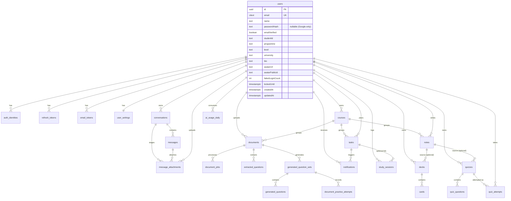

# Database

PostgreSQL 16, managed by Prisma migrations (`server/prisma/migrations`). All IDs are `uuid` (v4, `gen_random_uuid()`), timestamps are `timestamptz` (UTC). Every user-owned table has `userId` with `ON DELETE CASCADE`, so deleting a user removes all of their data in one statement.

## 1. ER diagram



(Other tables are detailed below to keep the diagram readable.)

## 2. Tables

Legend: **PK** primary key · **FK** foreign key · **UK** unique · `?` nullable.

### users

| Field                      | Type          | Notes                                              |
| -------------------------- | ------------- | -------------------------------------------------- |
| id                         | uuid PK       |                                                    |
| email                      | citext UK     | case-insensitive uniqueness (`citext` extension)   |
| name                       | varchar(100)  |                                                    |
| passwordHash               | text?         | argon2id; null for Google-only accounts            |
| emailVerified              | boolean       | default false                                      |
| studentId                  | varchar(50)?  |                                                    |
| programme                  | varchar(120)? |                                                    |
| level                      | varchar(30)?  | e.g. "Year 2", "MSc"                               |
| university                 | varchar(120)? |                                                    |
| bio                        | varchar(500)? |                                                    |
| avatarUrl / avatarPublicId | text?         | Cloudinary secure URL and public id (for deletion) |
| failedLoginCount           | int           | default 0; reset on success                        |
| lockedUntil                | timestamptz?  | temporary lockout                                  |
| createdAt, updatedAt       | timestamptz   |                                                    |

### auth_identities

Links external providers. `id`, `userId FK`, `provider` (`google`), `providerUserId`, `email`, `createdAt`. **UK** `(provider, providerUserId)`. Index `(userId)`.

### refresh_tokens

`id`, `userId FK`, `familyId uuid`, `tokenHash` (SHA-256 of random 256-bit token; raw token only in cookie), `expiresAt`, `revokedAt?`, `replacedById?`, `persistent boolean` (remember me), `userAgent?`, `ip?`, `createdAt`.
Indexes: **UK** `(tokenHash)`, `(userId)`, `(familyId)`, `(expiresAt)` for cleanup.

### email_tokens

`id`, `userId FK`, `type` enum(`verify_email`,`reset_password`), `tokenHash` **UK**, `expiresAt`, `usedAt?`, `createdAt`. Index `(userId, type)`. Creating a new token of a type invalidates older unused ones.

### user_settings (1:1, created with user)

`userId PK/FK`, `theme` enum(`system`,`light`,`dark`) default system, `timezone` text default 'UTC' (IANA), `notifyInApp` bool default true, `notifyEmailReminders` bool default false, `notifyProductEmail` bool default false, `focusMinutes` int 25, `shortBreakMinutes` int 5, `longBreakMinutes` int 15, `updatedAt`.
Checks: focus 1–180, breaks 1–60.

### conversations

`id`, `userId FK`, `title` varchar(120), `createdAt`, `updatedAt` (bumped on every message).
Index `(userId, updatedAt DESC)`.

### messages

`id`, `conversationId FK`, `userId FK` (denormalised for fast ownership checks), `role` enum(`user`,`assistant`), `content` text, `status` enum(`complete`,`partial`,`error`), `action?` enum(`explain_simple`,`example`,`quiz_me`,`summarize`), `inputTokens?`, `outputTokens?`, `model?`, `createdAt`.
Index `(conversationId, createdAt)`.

### message_attachments

`id`, `userId FK`, `conversationId FK`, `messageId? FK` (`ON DELETE CASCADE`, nullable while staged before message send), `originalName` varchar(255), `mimeType` varchar(120), `kind` enum(`image`,`document`), `sizeBytes` int, `storageKey` text, `storageUrl` text, `extractedText?` text, `truncated` boolean default false, `createdAt`.
Indexes: `(userId, createdAt)`, `(conversationId)`, `(messageId)`.

### documents

`id`, `userId FK`, `courseId? FK`, `title` varchar(200), `type` enum(`past_question`,`slides`,`notes`), `originalName` varchar(255), `mimeType` varchar(120), `kind` enum(`image`,`document`), `sizeBytes` int, `storageKey` text, `storageUrl` text, `extractedText` text, `pagesJson` jsonb, `pageCount` int, `truncated` boolean, `status` enum(`uploaded`,`extracting`,`ready`,`failed`), `errorMessage?` text, `createdAt`, `updatedAt`.

### document_jobs

`id`, `documentId FK`, `userId FK`, `kind` enum(`extract`,`detect_questions`,`generate_set`), `status` enum(`queued`,`running`,`completed`,`failed`), `progress` int, `payload` jsonb, `error?` text, `attempts` int, `runAt`, `startedAt?`, `finishedAt?`, `createdAt`.

### extracted_questions

`id`, `documentId FK`, `userId FK`, `position` int, `section?`, `questionNumber`, `prompt`, `marks?`, `instructions?`, `unclear` bool, `unclearReason?`, `selected` bool, `answerMode` enum(`full_worked`,`answers_only`,`marking_scheme`), `answerMarkdown?`, `thinkingMarkdown?`, `citedSourcesJson?`, `status` enum(`pending`,`answering`,`answered`,`error`), `createdAt`, `updatedAt`.

### generated_question_sets / generated_questions / document_practice_attempts

- `generated_question_sets`: `id`, `documentId FK`, `userId FK`, `title`, `settingsJson`, `quizId? FK`, `deckId? FK`, `createdAt`.
- `generated_questions`: `id`, `setId FK`, `position`, `type` enum(`mcq`,`true_false`,`short_answer`,`essay`,`fill_blank`,`calculation`,`flashcard`), `difficulty` enum(`easy`,`medium`,`hard`), `topic`, `prompt`, `optionsJson?`, `correctAnswer`, `explanation`, `sourceRef`, `createdAt`.
- `document_practice_attempts`: `id`, `setId FK`, `userId FK`, `answersJson`, `score`, `total`, `weakTopicsJson`, `feedbackJson`, `takenAt`.

### ai_usage_daily

`userId FK`, `day date` (UTC), `inputTokens`, `outputTokens`, `requests`. **PK** `(userId, day)`. Updated by `INSERT ... ON CONFLICT DO UPDATE` (atomic). Covers chat, summaries, flashcards and quizzes together (one budget).

### courses

`id`, `userId FK`, `name` varchar(80), `color` varchar(7)?, `createdAt`. **UK** `(userId, lower(name))`.

### notes

`id`, `userId FK`, `courseId FK?` (`ON DELETE SET NULL`), `title` varchar(200), `body` text (Markdown, max 100k chars), `aiSummary` text?, `searchVector` tsvector (generated: title weight A, body weight B), `createdAt`, `updatedAt`.
Indexes: `(userId, updatedAt DESC)`, `(userId, courseId)`, **GIN** `(searchVector)`.

### tasks

`id`, `userId FK`, `courseId FK?` (`SET NULL`), `title` varchar(200), `description` text?, `dueAt` timestamptz?, `priority` enum(`low`,`medium`,`high`) default medium, `status` enum(`todo`,`done`) default todo, `completedAt?`, `reminderOffsetMinutes int?` (null = none; 0, 60, 1440), `remindAt` timestamptz? (computed = dueAt − offset, recomputed on edit), `reminderSentAt?`, `createdAt`, `updatedAt`.
Indexes: `(userId, status, dueAt)`, partial `(remindAt) WHERE reminderSentAt IS NULL AND status='todo' AND remindAt IS NOT NULL` for the scheduler. Editing `dueAt`/offset resets `reminderSentAt` to null.

### notifications

`id`, `userId FK`, `type` enum(`task_reminder`,`system`), `title`, `body`, `taskId FK?` (`SET NULL`), `readAt?`, `createdAt`.
Also `dueAtSnapshot timestamptz?` (the task's `dueAt` when the reminder fired). Index `(userId, readAt, createdAt DESC)`. **UK** `(taskId, type, dueAtSnapshot)` enforces "one reminder per task per due date" even if the job misbehaves.

### study_sessions

`id`, `userId FK`, `taskId FK?` (`SET NULL`), `kind` enum(`focus`) (breaks are not logged), `startedAt`, `durationSeconds` int (check 60..14400), `source` enum(`pomodoro`,`manual`), `createdAt`.
Index: **UK** `(userId, startedAt)` (also makes `POST /study-sessions` idempotent across retries). Source of truth for **hours studied** and **streak**.

### decks / cards / review_logs

**decks:** `id`, `userId FK`, `noteId FK?` (`SET NULL`), `documentId FK?` (`SET NULL`), `courseId FK?` (`SET NULL`), `title` varchar(150), `topic?`, `createdAt`, `updatedAt`. Indexes `(userId, updatedAt DESC)`, `(userId, courseId)`, `(userId, documentId)`.
**cards:** `id`, `deckId FK`, `front` text, `back` text, `topic?`, `imageUrl?`, `imageStorageKey?`, `position` int, SM-2 fields (`easeFactor`, `intervalDays`, `repetitions`, `lapses`, `dueAt`, `lastReviewedAt`), `createdAt`. Indexes `(deckId, position)`, `(deckId, dueAt)`.
**review_logs:** `id`, `userId FK`, `cardId FK`, `deckId FK`, `courseId?`, `topic?`, `rating` enum(`again`,`hard`,`good`,`easy`), `quality` smallint, `previousIntervalDays`, `newIntervalDays`, `easeFactorAfter`, `reviewedAt`. Indexes `(userId, reviewedAt DESC)`, `(deckId, reviewedAt DESC)`, `(userId, courseId, reviewedAt DESC)`, `(cardId, reviewedAt DESC)`.

### timetable_entries / exams / revision_plans / revision_sessions

- **timetable_entries:** `id`, `userId FK`, `courseId FK` (`CASCADE`), `dayOfWeek` smallint (0–6), `startMinute`, `endMinute`, `venue?`, `type` enum(`lecture`,`lab`,`tutorial`,`seminar`). Index `(userId, dayOfWeek, startMinute)`.
- **exams:** `id`, `userId FK`, `courseId FK` (`CASCADE`), `title`, `examType` enum(`midterm`,`final`,`quiz`,`practical`), `startsAt` timestamptz, `durationMinutes`, `venue?`, `weightPercent?`, `topicsJson`, `reminderSentAt?`. Indexes `(userId, startsAt)`, `(userId, courseId, startsAt)`.
- **revision_plans / revision_sessions:** personalized AI revision schedules linked optionally to `examId`, `courseId`, and synced Planner `taskId`.

### grading_scales / grade_records

- **grading_scales:** `id`, `userId FK`, `name`, `maxGpa` float, `retakePolicy` enum(`latest`,`highest`), `isDefault` boolean, `boundariesJson` jsonb, `degreeClassesJson` jsonb. Index `(userId, isDefault)`.
- **grade_records:** `id`, `userId FK`, `courseId FK?` (`SET NULL`), `scaleId FK?` (`SET NULL`), `courseCode`, `courseTitle`, `creditHours`, `semester`, `semesterOrder`, `score?`, `gradeLabel`, `gradePoint`, `isRetake`, `retakeGroupKey`, `excludeFromGpa`. Indexes `(userId, semesterOrder, createdAt)`, `(userId, retakeGroupKey)`.

### quizzes / quiz_questions / quiz_attempts

**quizzes:** `id`, `userId FK`, `noteId FK?` (`SET NULL`), `title`, `topic?`, `createdAt`. Index `(userId, createdAt DESC)`.
**quiz_questions:** `id`, `quizId FK`, `position`, `prompt` text, `options` jsonb (array of 4 strings), `correctIndex` smallint (0–3), `explanation` text.
**quiz_attempts:** `id`, `quizId FK`, `userId FK`, `answers` jsonb (array of chosen indexes, `null` = skipped), `score` smallint (correct count), `total` smallint, `takenAt`. Indexes `(quizId, takenAt)`, `(userId, takenAt)`.
`correctIndex` is never returned by the "get quiz to take" endpoint; it is revealed in the attempt result.

## 3. Derived stats (all computed, nothing stored)

| Stat          | Query basis                                                                                                                                                                                                                                                                                                                                        |
| ------------- | -------------------------------------------------------------------------------------------------------------------------------------------------------------------------------------------------------------------------------------------------------------------------------------------------------------------------------------------------- |
| Hours studied | `SUM(study_sessions.durationSeconds)/3600` (also last 7 days)                                                                                                                                                                                                                                                                                      |
| Notes created | `COUNT(notes)`                                                                                                                                                                                                                                                                                                                                     |
| Quizzes taken | `COUNT(quiz_attempts)`                                                                                                                                                                                                                                                                                                                             |
| Study streak  | A **study day** is a local date (user timezone) with ≥ 1 `study_sessions` row or ≥ 1 `quiz_attempts` row. Streak = consecutive study days ending today, or ending yesterday if today has none yet. Computed from `SELECT DISTINCT date(timezone($tz, ts))` over the last 400 days, then counted in code (unit-tested with timezone and DST cases). |

## 4. Migrations and operations

- Schema source: `server/prisma/schema.prisma` (18 tables). Migrations: `20261116000000_init` (tables, enums, FKs, regular indexes, generated `searchVector`) and `20261116000100_constraints_and_search` (CHECK constraints, case-insensitive course-name unique index, GIN full-text index, partial reminder index), which Prisma's schema language cannot express.
- Primary keys use a database default (`gen_random_uuid()`); timestamps are `timestamptz(3)`.
- `prisma migrate dev` locally; `prisma migrate deploy` in production release command; migrations are committed and never edited after merge.
- Raw SQL migration steps (citext extension, generated tsvector column, GIN index, partial indexes, check constraints) live in the same migration files.
- Cleanup job (daily): delete expired/revoked refresh tokens older than 7 days, used/expired email tokens older than 7 days, notifications older than 90 days.
- Account deletion: single `DELETE FROM users WHERE id=?` cascade, then best-effort Cloudinary avatar deletion (failure logged; public id kept in an audit log line).
- Backups: Render managed daily backups (Phase 8 documents restore steps).
- Seed data: none in production. Dev seed script may create a local dev user via the real signup service only when `NODE_ENV=development`.
- **Admin Dashboard migration (`20261117000500_admin_dashboard`):**
  - Added `role` (`student` | `admin` | `super_admin`), `status` (`active` | `suspended`), `suspendedAt`, `suspendedReason`, `twoFactorEnabled`, `lastActiveAt` on `users`.
  - Added `EmailTokenType.admin_2fa`.
  - Added 10 tables: `audit_logs`, `app_settings`, `announcements`, `feedback_reports`, `flagged_contents`, `usage_events`, `activity_events`, `login_history`, `error_logs`, `admin_export_jobs`.
- **Academic & Analytics expansions (Courses, Timetable, Exams, SM-2 Flashcards, GPA, Storage/Privacy):**
  - Added `user_avatars` for persistent database-backed avatar storage fallback.
  - Expanded `courses` (`code`, `credits`, `semester`, `instructor`, `archivedAt`) and linked `courseId` across `notes`, `documents`, `study_documents`, `tasks`, `study_sessions`, `decks`, `quizzes`, `conversations`.
  - Added `timetable_entries` (weekday/minute slots, venue, type), `exams` (`midterm`/`final`/`quiz`/`practical`, countdown date, venue, weight, topics), `revision_plans` & `revision_sessions` (with `Notification` links via `timetableEntryId` and `examId` plus `classReminderMinutes`/`examReminderMinutes` in `user_settings`).
  - Added SM-2 fields (`topic`, `imageUrl`, `imageStorageKey`, `easeFactor`, `intervalDays`, `repetitions`, `lapses`, `dueAt`, `lastReviewedAt`) on `cards` and `review_logs` (`ReviewRating`: `again|hard|good|easy`) for spaced repetition & analytics.
  - Added `grading_scales` (configurable grade boundaries, degree classifications, retake policies `latest|highest`) and `grade_records` (`semester`, `semesterOrder`, `creditHours`, `score`, `gradeLabel`, `gradePoint`, `isRetake`, `retakeGroupKey`, `excludeFromGpa`).
  - Account deletion (`users` cascade) cleans up uploaded blobs across avatars, `message_attachments`, `documents`, and `cards.imageStorageKey`, and scrubs PII (`email`, `ip`, `userAgent`) from `login_history`.

## 5. Production Hardening, Least-Privilege Role & Backup/Restore Plan

- **Network & SSL:** Railway Postgres runs on private networking (`*.railway.internal`) with public proxy access disabled or restricted; `normalizeDatabaseUrl()` in `server/src/config/env.ts` automatically appends `sslmode=require` on external Railway proxy hosts (`*.rlwy.net` / `*.railway.app`).
- **Least-Privilege Application Role:** Run the API with a dedicated non-superuser role (`learnspace_app`) that has `SELECT, INSERT, UPDATE, DELETE` on `public` tables and `USAGE, SELECT` on sequences, while running `prisma migrate deploy` using the owner/migration role:
  ```sql
  CREATE ROLE learnspace_app LOGIN PASSWORD '<strong-random-password>' NOSUPERUSER NOCREATEDB NOCREATEROLE;
  GRANT USAGE ON SCHEMA public TO learnspace_app;
  GRANT SELECT, INSERT, UPDATE, DELETE ON ALL TABLES IN SCHEMA public TO learnspace_app;
  ALTER DEFAULT PRIVILEGES IN SCHEMA public GRANT SELECT, INSERT, UPDATE, DELETE ON TABLES TO learnspace_app;
  ```
- **Backup & Restore Plan:**
  - Enable daily automated snapshots in Railway PostgreSQL (**Database → Backups → Daily**) with 7–30 day retention.
  - Before major schema migrations, take an on-demand snapshot or encrypted `pg_dump --format=custom --no-owner` backup.
  - **Restore verification drill (monthly):** restore the latest snapshot into a staging Postgres service, run `npx prisma migrate status`, verify row counts (`users`, `notes`, `documents`, `audit_logs`), and confirm `/api/health/ready` returns `200`.

### Course Resource Recommendations & Caching

- **`course_recommendations`**: Stores verified web-search recommendations per course (`category`, `title`, `authors`, `edition`, `year`, `institutionOrBody`, `paperType`, `topicsJson`, `url`, `sourceDomain`, `accessType`, `reason`, `status`, `score`, `hidden`, `lastCheckedAt`). Unique on `(courseId, url)`.
- **`course_resources`**: Student's saved resources per course (`recommendationId`, `title`, `url`, `sourceDomain`, `accessType`). Paired with `courses.useResourcesInAssistant`.
- **`recommendation_jobs`**: Background job queue (`auto_create`, `refresh`, `find_more`, `link_recheck`) with `status`, `attempts`, `searchesRun`, `resultsCount`, `errorCode`, `errorMessage`.
- **`recommendation_cache`**: 30-day cache keyed by normalized `courseName::level` (`payloadJson`, `expiresAt`).
- **`recommendation_reports`**: Student-submitted bad/dead link reports (`url`, `sourceDomain`, `reason`, `status`).

### Collaboration & Community Tables

- **`communities` & `community_members`**: Course-matched communities (`slug = normalizedName::universityKey` or `normalizedName`) and per-user roles (`member`, `moderator`, `course_rep`) + `mutedUntil`.
- **`user_community_profiles`**: Helper reputation (`helpedCount`, `acceptedCount`), privacy toggles (`hideStats`, `showInClassmates`), `rulesAcceptedAt`, and `mutedUntil`.
- **`community_posts`, `community_replies`, `community_votes`, `community_attachments`**: Q&A threads with status (`unanswered | answered | resolved`), `isAnonymous`, `isPinned`, `acceptedReplyId`, unique votes per `(userId, targetType, targetId)`, and secure attachments.
- **`study_groups`, `study_group_members`, `study_group_messages`, `study_group_tasks`**: Course-scoped public or invite-only study groups, SSE-backed chat with `clientMessageId` deduplication, shared tasks, and Focus timer state.
- **`shared_resources`**: Read-only note copies, document summaries, and safe links shared with a course community or group.
- **`community_reports`, `user_blocks`, `moderation_actions`, `community_notification_preferences`**: Moderation queue, user blocking, audit trail, and granular in-app/email notification preferences.

## Ghanaian SHS & Child-Safety Tables

- **`users` (extended)**: `learnerType` (`university | shs`, default `university`), `schoolYear`, `schoolName`, `ageGroup` (`adult_18_plus | under_18`), `dateOfBirth`, `guardianConsentStatus` (`not_required | pending | given | withdrawn`).
- **`courses` (extended)**: `type` (`course | subject`, default `course`), `catalogueSubjectId` (optional FK to `subject_catalogue`).
- **`communities` & `community_reports` (extended)**: `communities.learnerScope` (`university | shs`) enforces strict space isolation; `community_reports.priority` (`normal | high`) prioritizes SHS reports.
- **`shs_programmes`, `subject_catalogue`, `subject_topics`**: Official NaCCA/GES SHS pathways, subjects, syllabus versions, citations, and topics.
- **`guardian_consents`**: Hashed single-use/withdrawal tokens (`tokenHash`), guardian email/phone, `status`, `consentedAt`, `withdrawnAt`, and IP.
- **`wassce_mock_attempts`**: Timed WASSCE mock exams (`objective | theory | mixed`), generated questions, student answers, scores, and `weakTopicsJson`.
- **`shs_moderation_flags`**: Flagged SHS AI prompts/outputs and community posts/messages (`source`, `direction`, `reason`, `excerpt`, `reviewed`).

## Topic Lessons & Progress Tables

- **`subject_topics` (extended)**: Added `strand`, `subStrand`, and `referenceNotes` (admin-supplied syllabus notes).
- **`topic_lessons`**: Stores AI-prepared structured JSON lessons once per topic (`topicId` unique, `contentJson`, `status: draft | reviewed | approved`, `version`, `reviewerId`, `reviewedAt`, `model`, `promptVersion`, `opensCount`).
- **`lesson_progress`**: Per-student progress (`userId`, `topicId` unique, `status: not_started | in_progress | completed`, `positionPct`, `timeSpentSeconds`, `completedAt`).
- **`lesson_reports`**: Student mistake reports (`userId`, `topicId`, `reason`, `status`).
