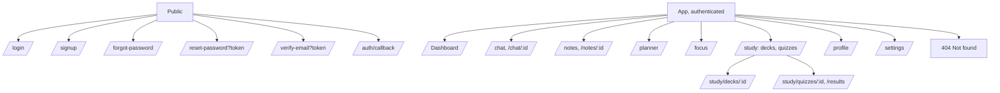
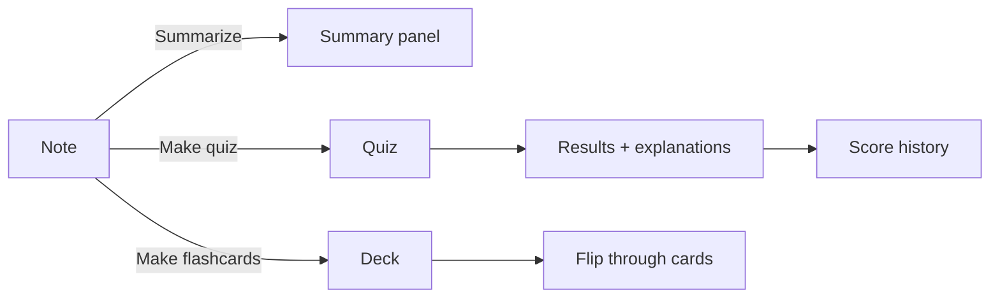

# UI / UX

Goal: **simple, clean, fast, reliable.** Calm and friendly; one primary colour plus neutrals; generous spacing; subtle motion.

## 1. Sitemap



Navigation: left sidebar on ≥ 1024 px (Dashboard, Assistant, Notes, Planner, Focus, Study, then Profile/Settings at bottom); bottom tab bar on mobile (Home, Assistant, Notes, Planner, More). Top bar: page title, notification bell, theme toggle, avatar menu.

## 2. Key user flows

**New user:** Sign up → dashboard with verify-email banner → empty states point to "Ask the tutor", "Create a note", "Start a focus session".

**Login:** `/login` → (validation inline) → dashboard or the `?next=` page. Failure shows a form-level alert; locked accounts show a countdown.

**Ask the tutor:** Assistant → New chat → type → tokens stream → copy / quick actions under reply → conversation appears in the list, renamed from first message.

**Notes to practice:** Notes → open note → "Summarize" / "Make flashcards" / "Make quiz" → result page → study → score saved.

**Focus:** Focus → pick task (optional) → Start → complete → toast "25 min logged" → streak updates.



## 3. Wireframes (low fidelity)

### Login / Sign-up (≥ 1024 px)
```
┌───────────────────────────────┬──────────────────────────────────┐
│  ░░ animated gradient ░░░░░░  │  LearnSpace ◐                    │
│  ░  floating shapes     ░░░░  │                                  │
│  ░  "Learn better,      ░░░░  │  Welcome back                    │
│  ░   together with AI"  ░░░░  │  Log in to continue              │
│  ░  • tutor • notes     ░░░░  │  [ Continue with Google ]        │
│  ░  • quizzes • focus   ░░░░  │  ───────── or ─────────          │
│  ░░░░░░░░░░░░░░░░░░░░░░░░░░░  │  Email    [______________]       │
│                               │  Password [__________] 👁        │
│                               │  ☐ Remember me   Forgot password?│
│                               │  [        Log in         ]       │
│                               │  New here? Create an account     │
└───────────────────────────────┴──────────────────────────────────┘
```
Mobile: gradient becomes a short header strip; form below. Sign-up adds Name and a live password-strength/requirements checklist.

### Dashboard
```
┌ Sidebar ┬────────────────────────────────────────────────────────┐
│ ◼ Home  │ Good evening, Ama 👋              🔔  ◐  (avatar)       │
│ 💬 Chat │ ┌ Streak ─┐ ┌ This week ┐ ┌ Quick links ──────────────┐ │
│ 📝 Notes│ │ 🔥 5 day│ │ 6.3 hours │ │ [New chat][New note]      │ │
│ ✅ Plan │ └─────────┘ └───────────┘ │ [Start focus][Make quiz]  │ │
│ ⏱ Focus │ ┌ Today's tasks ─────────┐└───────────────────────────┘ │
│ 🎓 Study│ │ ☐ Read ch.4  (due 5pm) │ ┌ Recent chats ────────────┐  │
│         │ │ ☑ Lab report           │ │ Recursion basics         │  │
│ Profile │ │ + Add task             │ │ Organic chem reactions   │  │
└─────────┴────────────────────────────────────────────────────────┘
```

### AI Assistant
```
┌ Conversations ──┬─────────────────────────────────────────────┐
│ [+ New chat]    │ Recursion basics            ✎ rename  🗑      │
│ 🔍 search       │ ──────────────────────────────────────────  │
│ ▸ Recursion     │            You: Explain recursion           │
│   Organic chem  │ Tutor: Think of Russian dolls… ⧉ copy       │
│                 │   ```python … ```  ⧉                         │
│                 │   [Explain simply][Example][Quiz me][Summarize]│
│                 │ ┌──────────────────────────────────┐ ⏹/➤    │
│                 │ │ Ask anything…  (Enter to send)   │ 12k/100k│
│                 │ └──────────────────────────────────┘ tokens  │
└─────────────────┴─────────────────────────────────────────────┘
```
Mobile: conversation list is a drawer.

### Profile
```
[Avatar ⬆]  Ama Mensah  · ama@uni.edu ✓
┌ Stats ────────────────────────────────────────────────┐
│ 🔥 5-day streak │ ⏱ 38.5 h │ 📝 14 notes │ 🎯 9 quizzes │
└───────────────────────────────────────────────────────┘
Tabs: Details | Security
Details: Name, Student ID, Programme, Level, University, Bio  [Save]
Security: Change password · Log out everywhere · Danger zone: Delete account
```

### Notes / Planner / Focus / Study (summaries)
- **Notes:** left course list + search; middle note list; right editor (Markdown write/preview tabs, course select, Summarize / Flashcards / Quiz buttons). Mobile: stacked views.
- **Planner:** tabs Today · Upcoming · Overdue · Done; task rows with checkbox, due chip, course chip, priority dot; "+ Add task" opens a drawer with reminder select.
- **Focus:** large circular timer, Focus/Short/Long tabs, Start/Pause/Reset, optional task select, today's total below.
- **Study:** Decks and Quizzes tabs; deck study mode is a single flip card with "Again / Got it"; quiz is one question per screen with progress bar; results show score ring, per-question explanations, and a line chart of past scores.

## 4. Screen states (required for every screen)

| State | Pattern |
|---|---|
| Loading | Skeletons shaped like final content (no spinners over blank pages); button-level spinners for submits |
| Empty | Friendly illustration/emoji, one sentence, one primary action |
| Error | Inline `ErrorState` with message and **Retry**; form errors next to fields + a summary `role="alert"`; toasts for transient errors |
| Offline / slow | Banner "You're offline" when `navigator.onLine` is false; retries via TanStack Query |
| Unverified | Dismissible banner with "Resend email"; AI buttons show a tooltip explaining why disabled |

## 5. Design tokens (single source of truth)

Defined once in `client/src/design/tokens.css` as CSS variables, consumed by the Tailwind preset (`theme.extend.colors = { primary: 'rgb(var(--color-primary) / <alpha-value>)' … }`). Components never use raw hex values.

```css
:root {
  /* Colour: one primary + neutrals + semantic */
  --color-primary-50:  238 242 255;  --color-primary-100: 224 231 255;
  --color-primary-500: 99 102 241;   --color-primary-600: 79 70 229;  --color-primary-700: 67 56 202;
  --color-bg: 249 250 251;           --color-surface: 255 255 255;    --color-surface-2: 243 244 246;
  --color-border: 229 231 235;       --color-text: 17 24 39;          --color-text-muted: 75 85 99;
  --color-success: 22 163 74;  --color-warning: 217 119 6;  --color-danger: 220 38 38;  --color-info: 37 99 235;

  /* Typography */
  --font-sans: 'Inter', system-ui, sans-serif;  --font-display: 'Poppins', 'Inter', sans-serif;
  --text-xs: 0.75rem; --text-sm: 0.875rem; --text-base: 1rem; --text-lg: 1.125rem;
  --text-xl: 1.25rem; --text-2xl: 1.5rem; --text-3xl: 1.875rem;

  /* Spacing (4px base) */  --space-1: .25rem; --space-2: .5rem; --space-3: .75rem; --space-4: 1rem;
  --space-6: 1.5rem; --space-8: 2rem; --space-12: 3rem;

  /* Shape and depth */
  --radius-sm: .5rem; --radius-md: .75rem; --radius-lg: 1rem; --radius-xl: 1.5rem; --radius-full: 9999px;
  --shadow-sm: 0 1px 2px rgb(0 0 0 / .06);
  --shadow-md: 0 4px 12px rgb(0 0 0 / .08);
  --shadow-lg: 0 12px 32px rgb(0 0 0 / .12);

  /* Motion */ --ease: cubic-bezier(.2,.8,.2,1); --dur-fast: 120ms; --dur-base: 200ms; --dur-slow: 400ms;
  /* Layout */ --sidebar-w: 16rem; --content-max: 72rem;
}
.dark {
  --color-bg: 11 15 25;  --color-surface: 17 24 39;  --color-surface-2: 31 41 55;
  --color-border: 55 65 81;  --color-text: 243 244 246;  --color-text-muted: 156 163 175;
  --color-primary-500: 129 140 248;  /* lighter accent for text/rings; button fill (600) is unchanged for white-text contrast */
  --color-primary-50: 30 27 75;  --color-primary-100: 49 46 129;
}
@media (prefers-reduced-motion: reduce) { :root { --dur-fast: 0ms; --dur-base: 0ms; --dur-slow: 0ms; } }
```
Contrast: primary-600 on white = 6.3:1 (AA); muted text on bg ≥ 4.5:1; dark mode values are checked with an automated axe test in Phase 7. Breakpoints (Tailwind): `sm 640`, `md 768`, `lg 1024`, `xl 1280`.

## 6. Components (design system, Phase 1)
Button (primary/secondary/ghost/danger, loading), IconButton, Input, PasswordInput, Textarea, Select, Checkbox, Switch, Field (label + hint + error), Card, Badge, Avatar, Tabs, Modal/Drawer (focus trap), Toast, Tooltip, Skeleton, EmptyState, ErrorState, Spinner, ProgressRing, ThemeToggle, Markdown.

## 7. Motion and microinteractions
Fade/slide-up on page enter (200 ms); button press scale 0.98; input focus ring grows; error shake once (disabled with reduced motion); animated gradient background on the auth panel (CSS only, GPU-friendly, paused under reduced motion); streaming text appears without layout jump; checkbox completion animates strike-through.

## 8. Accessibility checklist
Visible labels on all inputs · `aria-invalid` + `aria-describedby` for errors · focus-visible rings (2 px primary) · skip-to-content link · logical heading order · modals trap focus and restore it · `aria-live="polite"` for streamed replies and toasts · icons have text or `aria-label` · targets ≥ 44 px on mobile · works with keyboard only (including chat, timer, tabs) · colour is never the only signal · timer announces completion.

## 9. Admin Console UI
- **Layout:** Dedicated collapsible sidebar (`Overview`, `Users`, `AI Usage`, `Content`, `Learning`, `Announcements`, `Feedback`, `Audit Log`, `System`, `Settings`, `Reports`), top bar with search, light/dark toggle, and admin profile menu.
- **Data & Feedback:** Tables include sticky headers, filters, sorting, loading skeletons, empty states, and confirmation modals for destructive or moderation actions. Charts use `recharts` and display empty states when no data exists.
- **Student Integration:** `AppLayout` surfaces active announcements, maintenance mode banners, and a floating **Feedback** modal for bug, suggestion, and abuse reports.

